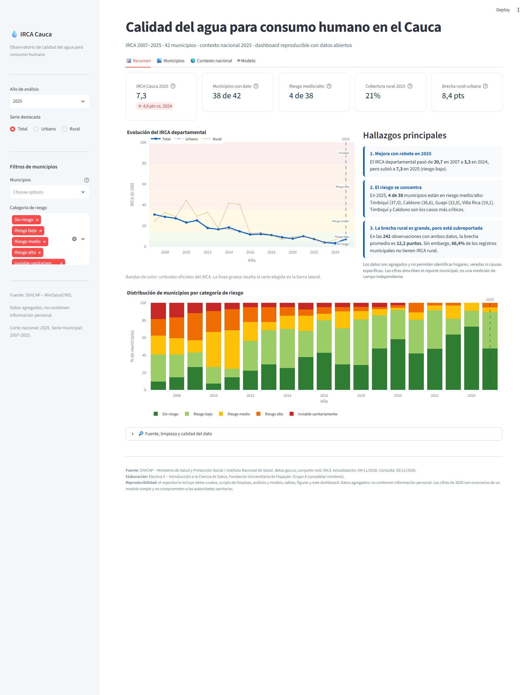
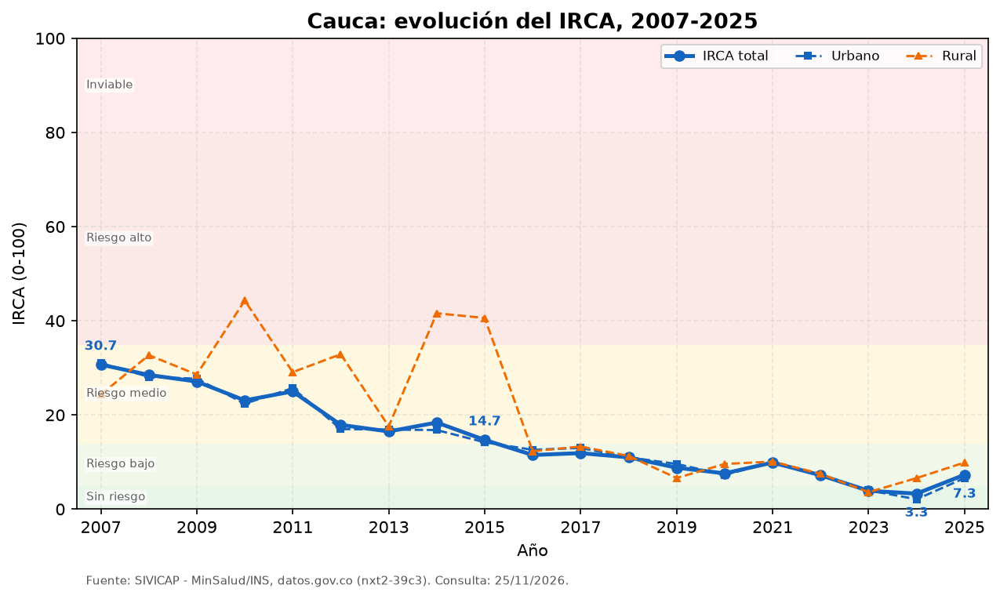
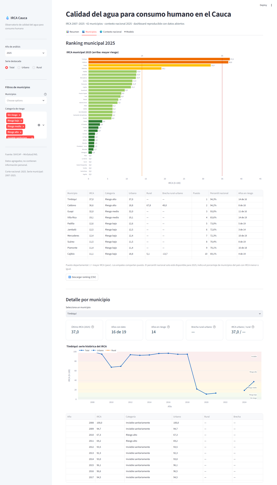
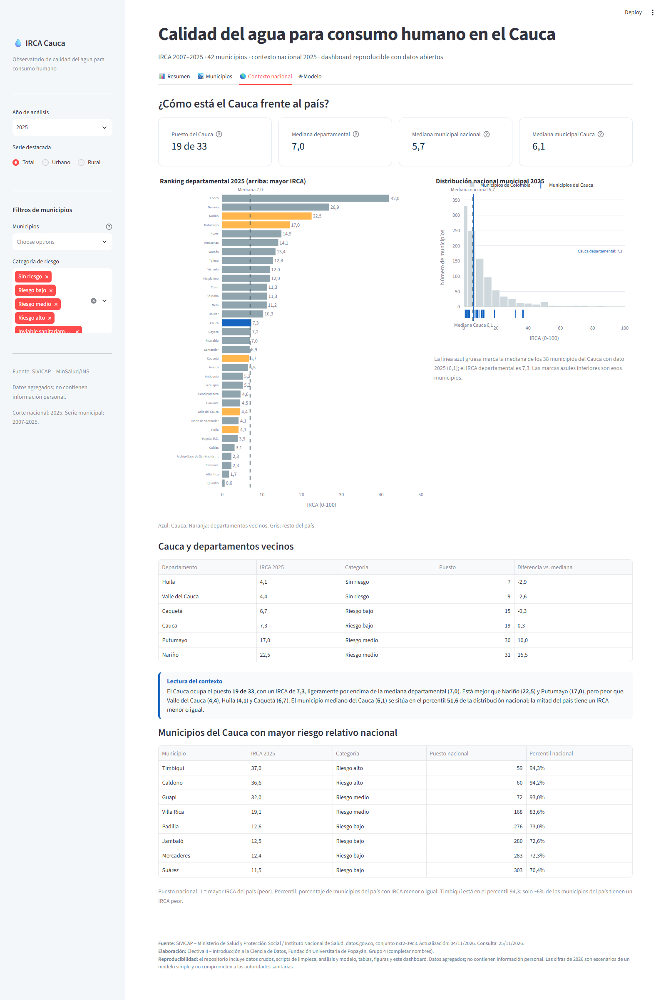
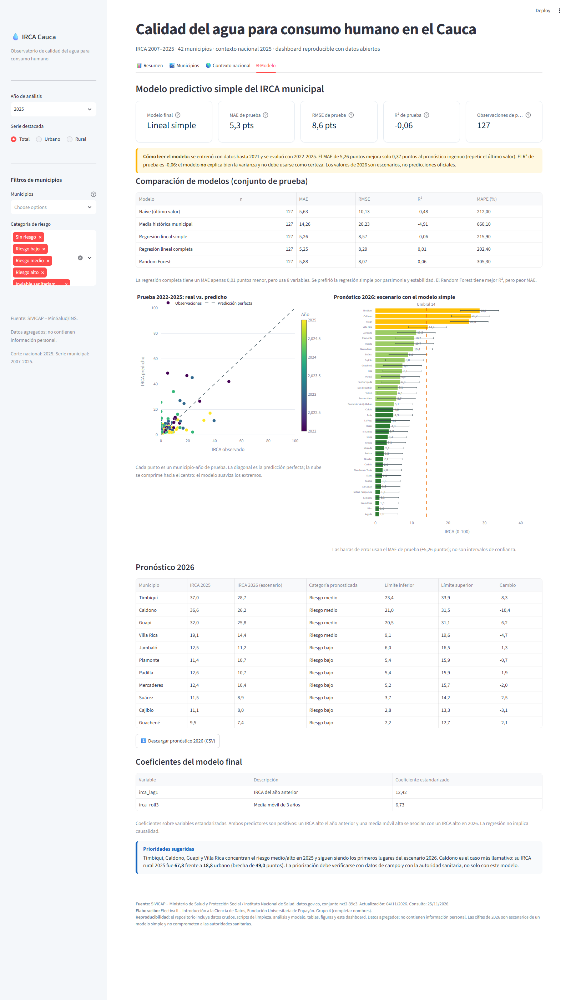
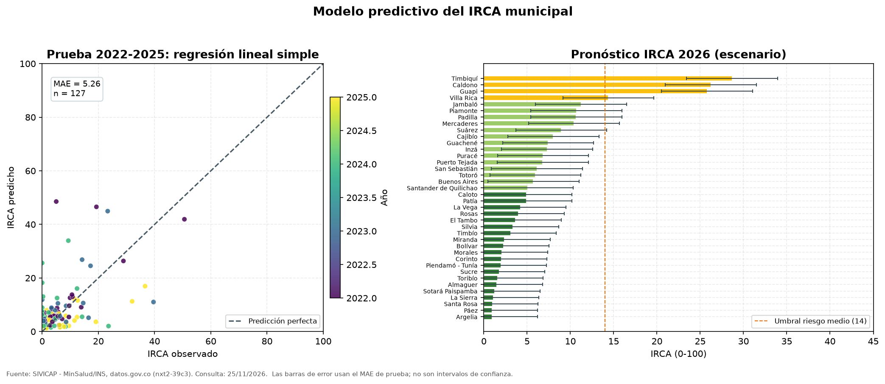
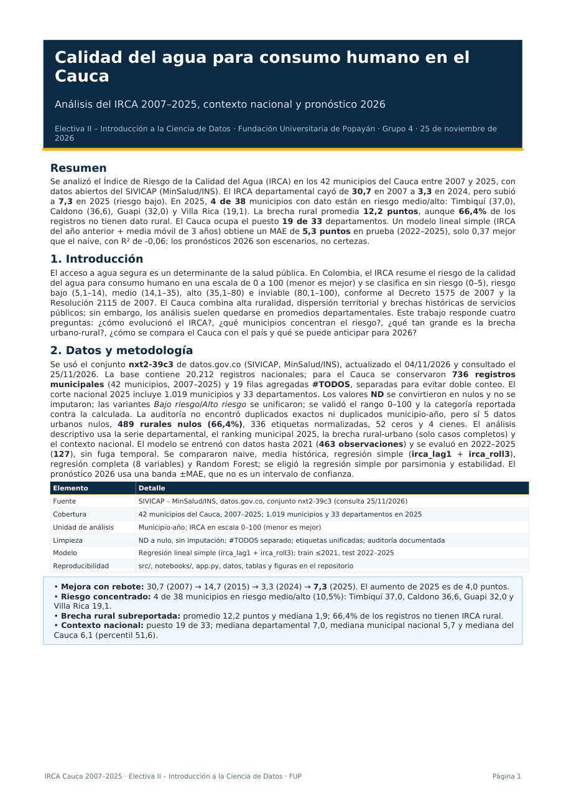

<div align="center">

# Calidad del Agua para Consumo Humano en el Cauca

### Análisis del IRCA 2007–2025 · Contexto Nacional · Pronóstico 2026

**Observatorio reproducible de la calidad del agua para consumo humano en los 42 municipios del Cauca, construido con datos abiertos, Python y Streamlit.**


<br>



<sub>Vista del dashboard interactivo · pestaña Resumen</sub>

</div>

---

## Tabla de Contenidos

- [Qué es este proyecto](#qué-es-este-proyecto)
- [Highlights](#highlights)
- [Hallazgos Principales](#hallazgos-principales)
- [El Dashboard](#el-dashboard)
- [Metodología](#metodología)
- [Modelo Predictivo](#modelo-predictivo)
- [Fuente de Datos](#fuente-de-datos)
- [Estructura del Repositorio](#estructura-del-repositorio)
- [Inicio Rápido](#inicio-rápido)
- [Reproducir el Pipeline](#reproducir-el-pipeline)
- [Informe y Anexos](#informe-y-anexos)
- [Video](#video)
- [Despliegue](#despliegue)
- [Equipo](#equipo)
- [Limitaciones](#limitaciones)
- [Reproducibilidad y Buenas Prácticas](#reproducibilidad-y-buenas-prácticas)
- [Cómo Citar](#cómo-citar)
- [Licencia](#licencia)

---

## Qué es este proyecto

Un análisis reproducible de la calidad del agua para consumo humano en los **42 municipios del Cauca** entre **2007 y 2025**, usando el **Índice de Riesgo de la Calidad del Agua (IRCA)** del SIVICAP (Ministerio de Salud y Protección Social / Instituto Nacional de Salud).

El proyecto integra todo el ciclo de un proyecto de ciencia de datos, de principio a fin:

| Limpieza | Análisis | Dashboard | Modelo | Comunicación |
|:---:|:---:|:---:|:---:|:---:|
| Auditoría de datos abiertos | Descriptivo + contexto nacional | Streamlit + Plotly | Regresión + escenario 2026 | Informe 3 pág. + anexos + video |

> Proyecto final de Electiva II – Introducción a la Ciencia de Datos · Fundación Universitaria de Popayán · Grupo 4 · 25 de noviembre de 2026

---

## Highlights

| Logro | Detalle |
|:---|:---|
| **IRCA Cauca 2007 → 2024** | Cae de **30,7** (riesgo medio) a **3,3** (sin riesgo) |
| **Cobertura** | 42 municipios · 736 registros · 19 años (2007–2025) |
| **Contexto nacional** | 1.019 municipios y 33 departamentos en el corte 2025 |
| **Pronóstico 2026** | 4 en riesgo medio · 14 bajo · 20 sin riesgo |
| **Pipeline 100% reproducible** | Datos crudos → limpieza → análisis → modelo → informe |
| **Código + datos + figuras** | Todo versionado, con hashes SHA-256 y semilla fija |

---

## Hallazgos Principales

| Indicador | Resultado |
|:---|:---:|
| IRCA del Cauca 2007 | **30,7** (riesgo medio) |
| IRCA del Cauca 2024 | **3,3** (sin riesgo) |
| IRCA del Cauca 2025 | **7,3** (riesgo bajo) |
| Municipios con dato en 2025 | **38 de 42** |
| Municipios en riesgo medio/alto 2025 | **4 de 38 (10,5%)** |
| Casos más críticos 2025 | **Timbiquí 37,0 · Caldono 36,6 · Guapi 32,0 · Villa Rica 19,1** |
| Brecha rural-urbano | **12,2 puntos** de promedio; **1,9** de mediana |
| Registros sin IRCA rural | **489 de 736 (66,4%)** |
| Puesto nacional 2025 | **19 de 33** departamentos |
| Modelo final | Regresión lineal simple (`irca_lag1` + `irca_roll3`) |
| MAE de prueba | **5,26** vs. **5,63** del naive; R² **−0,06** |
| Pronóstico 2026 | **4** riesgo medio · **14** bajo · **20** sin riesgo |

> **Lectura corta:** el Cauca mejoró mucho desde 2007, pero en 2025 hay un rebote que debe monitorearse. El riesgo está concentrado en cuatro municipios y la brecha rural está subreportada: dos de cada tres registros no tienen IRCA rural. El modelo es un tamiz, no una certeza.

<div align="center">

<sub>Figura 1 · Evolución del IRCA departamental con bandas de riesgo oficiales</sub>
</div>

---

## El Dashboard

El dashboard interactivo tiene cuatro pestañas:

| Pestaña | Contenido |
|:---|:---|
| **Resumen** | KPIs del año seleccionado, evolución del IRCA y distribución por categoría |
| **Municipios** | Ranking filtrable, ficha por municipio, serie histórica y descarga CSV |
| **Contexto nacional** | Comparación del Cauca con los 33 departamentos y los municipios del país en 2025 |
| **Modelo** | Métricas, coeficientes, real vs. predicho y pronóstico 2026 con banda de error |

**Filtros de la barra lateral:** año de análisis, serie destacada (total, urbana o rural), municipios y categoría de riesgo.

<div align="center">





<sub>Capturas reales del dashboard · pestañas Municipios, Contexto y Modelo</sub>

</div>

---

## Metodología

```text
┌────────────┐   ┌────────────┐   ┌────────────┐   ┌────────────┐   ┌────────────┐
│  Datos     │──▶│  Limpieza  │──▶│  Análisis  │──▶│  Modelo    │──▶│  Informe   │
│  abiertos  │   │  + auditoría│  │ descriptivo│   │  + 2026    │   │  + video   │
│  SIVICAP   │   │            │   │  + nacional│   │            │   │            │
└────────────┘   └────────────┘   └────────────┘   └────────────┘   └────────────┘
```

**Decisiones clave de limpieza:**

- Los valores `ND` se conservan como nulos (no se imputan).
- Las variantes `Bajo riesgo` / `Alto riesgo` se unifican.
- Los agregados `#TODOS` se separan para evitar doble conteo.
- El IRCA se calcula con los umbrales oficiales (5, 14, 35 y 80).
- Auditoría de duplicados, rangos, categorías y etiquetas.

---

## Modelo Predictivo

- **Unidad:** municipio-año, con grilla anual completa 2007–2026 (rezagos de año calendario).
- **Variables finales:** `irca_lag1` (IRCA del año anterior) + `irca_roll3` (media móvil de 3 años).
- **Entrenamiento:** ≤2021 (463 obs.) · **Prueba:** 2022–2025 (127 obs.).
- **Comparación:** naive, media histórica, regresión simple, regresión completa (8 variables) y Random Forest.
- **Modelo elegido:** regresión lineal simple, por parsimonia y estabilidad.

| Métrica (prueba) | Modelo final | Naive |
|:---|:---:|:---:|
| **MAE** | **5,26** | 5,63 |
| **RMSE** | 8,57 | — |
| **R²** | −0,06 | — |

> **Advertencia:** el R² de prueba negativo y la mejora modesta sobre el naive indican que el modelo no debe usarse como certeza ni para asignar recursos sin validación. Es una herramienta de tamizaje y exploración. La banda ±MAE no es un intervalo de confianza.

<div align="center">

<sub>Figura 7 · Real vs. predicho y pronóstico 2026</sub>
</div>

---

## Fuente de Datos

| Campo | Detalle |
|:---|:---|
| **Conjunto** | `nxt2-39c3` — *Calidad del Agua para Consumo Humano en Colombia (SIVICAP)* |
| **Entidad** | Ministerio de Salud y Protección Social / Instituto Nacional de Salud |
| **Portal** | https://www.datos.gov.co/d/nxt2-39c3 |
| **API** | https://www.datos.gov.co/resource/nxt2-39c3.json |
| **Actualización** | 04/11/2026 · **Consulta:** 25/11/2026 |
| **Cobertura** | 42 municipios del Cauca (736 registros) · 1.019 municipios y 33 departamentos (corte 2025) |
| **Datos personales** | No contiene información personal; el IRCA es un indicador agregado |

Los detalles de descarga, columnas y decisiones de limpieza están en [`data/README.md`](data/README.md).

---

## Estructura del Repositorio

```text
.
├── app.py                         # Dashboard Streamlit (4 pestañas)
├── requirements.txt               # Dependencias mínimas del dashboard
├── requirements-dev.txt           # Dependencias del pipeline completo
├── runtime.txt                    # Versión de Python para Streamlit Cloud
├── data/
│   ├── README.md                  # Fuente, descarga, hashes y limpieza
│   ├── raw/                       # Datos crudos (JSON canónico + CSV de respaldo)
│   └── clean/                     # Datos limpios + diccionario
├── src/
│   ├── config.py                  # Rutas, umbrales, catálogo y colores
│   ├── cleaning.py                # Limpieza y auditoría reproducible
│   ├── analysis.py                # Tablas y figuras descriptivas
│   └── model.py                   # Panel, modelos y pronóstico 2026
├── notebooks/                     # 01_limpieza · 02_analisis · 03_modelo (ejecutados)
├── figures/                       # 8 figuras PNG
├── reports/
│   ├── informe_final.pdf / .md    # Informe principal (3 páginas)
│   ├── anexos.pdf / .md           # Anexos (6 páginas)
│   ├── tablas/                    # CSV de tablas y métricas
│   └── capturas/                  # Capturas del dashboard e informe
├── scripts/                       # Pipeline, notebooks, informe, anexos, capturas
├── docs/                          # Hoja de ruta, despliegue, equipo
├── video/guion_video.md           # Guion de 8–10 min para 4 voceros
└── Guia_Proyecto_Final_Electiva_II_FUP.pdf
```

---

## Inicio Rápido

### 1. Clonar e instalar

```bash
git clone https://github.com/CesarMauriciof/dashboard-analisis-agua-cauca.git
cd dashboard-analisis-agua-cauca

python -m venv .venv
# Windows
.venv\Scripts\activate
# macOS / Linux
source .venv/bin/activate

pip install -r requirements-dev.txt
```

Si solo se quiere ver el dashboard:

```bash
pip install -r requirements.txt
```

### 2. Ejecutar el dashboard

```bash
python -m streamlit run app.py
```

Abrir `http://localhost:8501`. En Windows, si hay problemas de acentos en la consola:

```bash
set PYTHONIOENCODING=utf-8
python -m streamlit run app.py
```

---

## Reproducir el Pipeline

```bash
python scripts/run_all.py
```

O por pasos:

```bash
python -m src.cleaning          # Limpieza y auditoría
python -m src.analysis          # Tablas y figuras
python -m src.model             # Modelo y pronóstico 2026
python scripts/crear_notebooks.py
python scripts/ejecutar_notebooks.py
python scripts/generar_informe.py
python scripts/generar_anexos.py
```

Para omitir la ejecución de notebooks (más rápido):

```bash
python scripts/run_all.py --sin-notebooks
```

> **Nota:** el pipeline lee `data/raw/irca_colombia_raw.json`. Si se descarga de nuevo, usar la API y guardar el JSON en esa ruta.

---

## Informe y Anexos

| Documento | Contenido |
|:---|:---|
| [**Informe principal**](reports/informe_final.pdf) | **3 páginas**: resumen, introducción, datos y metodología, resultados, discusión, conclusiones, limitaciones y referencias |
| [**Anexos**](reports/anexos.pdf) | **6 páginas**: ranking completo, serie anual, brecha, contexto nacional, métricas, coeficientes, pronóstico, diccionario y auditoría |
| Versiones Markdown | [`informe_final.md`](reports/informe_final.md) · [`anexos.md`](reports/anexos.md) |

<div align="center">

<sub>Primera página del informe renderizado</sub>
</div>

Para regenerar:

```bash
python scripts/generar_informe.py
python scripts/generar_anexos.py
```

---

## Video

El guion completo está en [`video/guion_video.md`](video/guion_video.md). Incluye reparto de cuatro voceros con tiempos equilibrados, storyboard con evidencia en pantalla, guion literal de 8–10 minutos, checklist de grabación y preguntas probables del jurado.

---

## Despliegue

El proyecto está preparado para Streamlit Community Cloud:

1. Subir el repositorio a GitHub (incluye `data/clean/`, `reports/tablas/` y `app.py`).
2. Entrar a [share.streamlit.io](https://share.streamlit.io) con la cuenta de GitHub.
3. **New app** → repositorio → rama `main` → archivo `app.py`.
4. Elegir Python 3.12 (`runtime.txt`) → **Deploy**.

El paso a paso detallado está en [`docs/despliegue.md`](docs/despliegue.md).

---

## Equipo

| Integrante | Rol principal | Aportes |
|:---|:---|:---|
| **[Nombre A]** | Datos y limpieza | Descarga, limpieza, auditoría, diccionario |
| **[Nombre B]** | Análisis descriptivo | Evolución, ranking, brecha urbano-rural |
| **[Nombre C]** | Contexto y modelo | Comparación nacional, modelo, pronóstico |
| **[Nombre D]** | Dashboard y comunicación | Streamlit, capturas, informe, video |

Completar nombres y aportes en [`docs/equipo.md`](docs/equipo.md).

---

## Limitaciones

- El IRCA es un indicador agregado por municipio y año; no identifica hogares, veredas ni causas.
- **66,4%** de los registros municipales no tienen IRCA rural; en 2025 solo 8 de 38 municipios tienen dato rural.
- **Popayán** solo tiene datos de 2008 a 2019; en 2025 faltan Balboa, Florencia, López de Micay y Popayán.
- Hay ceros y saltos abruptos que pueden reflejar cambios de reporte, no cambios reales.
- El modelo tiene R² de prueba negativo y una mejora modesta sobre el naive; la banda ±MAE no es un intervalo de confianza.

---

## Reproducibilidad y Buenas Prácticas

- Semilla fija en el Random Forest (`random_state=42`).
- Separación temporal estricta: entrenamiento ≤2021, prueba 2022–2025.
- Sin imputación de datos rurales; se declaran los sesgos.
- Auditoría de duplicados, rangos, categorías y etiquetas.
- Formatos colombianos en la interfaz y los informes (coma decimal, punto de miles).
- Código y notebooks ejecutados; el pipeline corre de principio a fin.

---

## Cómo Citar

```text
Grupo 4, Electiva II – Introducción a la Ciencia de Datos, Fundación Universitaria de Popayán.
Calidad del agua para consumo humano en el Cauca: análisis del IRCA 2007–2025 y pronóstico 2026.
Popayán, 2026.
```

**Fuente de datos:**

```text
Ministerio de Salud y Protección Social, Instituto Nacional de Salud.
Calidad del Agua para Consumo Humano en Colombia (SIVICAP).
datos.gov.co, conjunto nxt2-39c3, 2026. https://www.datos.gov.co/d/nxt2-39c3
```

---

## Licencia

El código de este repositorio se distribuye bajo licencia **MIT** (ver [`LICENSE`](LICENSE)).
Los datos pertenecen al Ministerio de Salud y Protección Social / Instituto Nacional de Salud y se usan conforme a las condiciones de datos abiertos de datos.gov.co. Los textos y figuras del informe son de elaboración propia.

---

<div align="center">

<sub>Hecho con Python, Streamlit y datos abiertos · Fundación Universitaria de Popayán · 2026</sub>

</div>