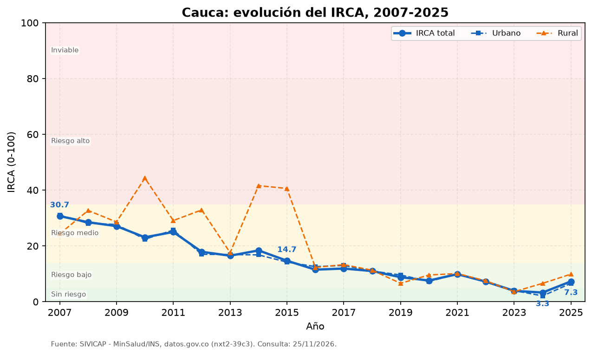
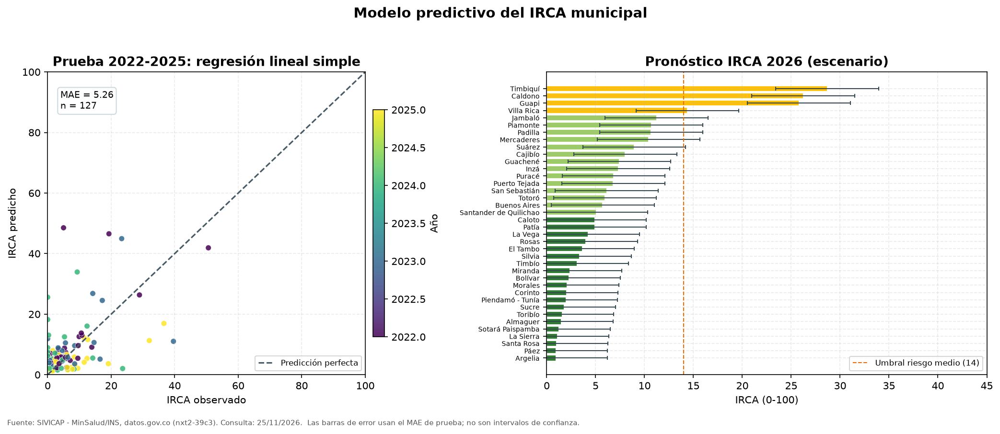

# Calidad del agua para consumo humano en el Cauca

**Análisis del IRCA 2007–2025, contexto nacional y pronóstico 2026**

Electiva II – Introducción a la Ciencia de Datos · Fundación Universitaria de Popayán · Grupo 4 · 25 de noviembre de 2026

> Versión Markdown del informe. El PDF de 3 páginas es `reports/informe_final.pdf`; los anexos están en `reports/anexos.md` y `reports/anexos.pdf`.

## Resumen

Se analizó el Índice de Riesgo de la Calidad del Agua (IRCA) en los 42 municipios del Cauca entre 2007 y 2025, con datos abiertos del SIVICAP (MinSalud/INS). El IRCA departamental cayó de <b>30,7</b> en 2007 a <b>3,3</b> en 2024, pero subió a <b>7,3</b> en 2025 (riesgo bajo). En 2025, <b>4 de 38</b> municipios con dato están en riesgo medio/alto: Timbiquí (37,0), Caldono (36,6), Guapi (32,0) y Villa Rica (19,1). La brecha rural promedia <b>12,2 puntos</b>, aunque <b>66,4%</b> de los registros no tienen dato rural. El Cauca ocupa el puesto <b>19 de 33</b> departamentos. Un modelo lineal simple (IRCA del año anterior + media móvil de 3 años) obtiene un MAE de <b>5,3 puntos</b> en prueba (2022–2025), solo 0,37 mejor que el naive, con R² de -0,06; los pronósticos 2026 son escenarios, no certezas.

## 1. Introducción

El acceso a agua segura es un determinante de la salud pública. En Colombia, el IRCA resume el riesgo de la calidad del agua para consumo humano en una escala de 0 a 100 (menor es mejor) y se clasifica en sin riesgo (0–5), riesgo bajo (5,1–14), medio (14,1–35), alto (35,1–80) e inviable (80,1–100), conforme al Decreto 1575 de 2007 y la Resolución 2115 de 2007. El Cauca combina alta ruralidad, dispersión territorial y brechas históricas de servicios públicos; sin embargo, los análisis suelen quedarse en promedios departamentales. Este trabajo responde cuatro preguntas: ¿cómo evolucionó el IRCA?, ¿qué municipios concentran el riesgo?, ¿qué tan grande es la brecha urbano-rural?, ¿cómo se compara el Cauca con el país y qué se puede anticipar para 2026?

## 2. Datos y metodología

Se usó el conjunto <b>nxt2-39c3</b> de datos.gov.co (SIVICAP, MinSalud/INS), actualizado el 04/11/2026 y consultado el 25/11/2026. La base contiene 20.212 registros nacionales; para el Cauca se conservaron <b>736 registros municipales</b> (42 municipios, 2007–2025) y 19 filas agregadas <b>#TODOS</b>, separadas para evitar doble conteo. El corte nacional 2025 incluye 1.019 municipios y 33 departamentos. Los valores <b>ND</b> se convirtieron en nulos y no se imputaron; las variantes <i>Bajo riesgo</i>/<i>Alto riesgo</i> se unificaron; se validó el rango 0–100 y la categoría reportada contra la calculada. La auditoría no encontró duplicados exactos ni duplicados municipio-año, pero sí 5 datos urbanos nulos, <b>489 rurales nulos (66,4%)</b>, 336 etiquetas normalizadas, 52 ceros y 4 cienes. El análisis descriptivo usa la serie departamental, el ranking municipal 2025, la brecha rural-urbano (solo casos completos) y el contexto nacional. El modelo se entrenó con datos hasta 2021 (<b>463 observaciones</b>) y se evaluó en 2022–2025 (<b>127</b>), sin fuga temporal. Se compararon naive, media histórica, regresión simple (<b>irca_lag1</b> + <b>irca_roll3</b>), regresión completa (8 variables) y Random Forest; se eligió la regresión simple por parsimonia y estabilidad. El pronóstico 2026 usa una banda ±MAE, que no es un intervalo de confianza.

| Elemento | Detalle |
|---|---|
| Fuente | SIVICAP – MinSalud/INS, datos.gov.co, conjunto nxt2-39c3 (consulta 25/11/2026) |
| Cobertura | 42 municipios del Cauca, 2007–2025; 1.019 municipios y 33 departamentos en 2025 |
| Unidad de análisis | Municipio-año; IRCA en escala 0–100 (menor es mejor) |
| Limpieza | ND a nulo, sin imputación; #TODOS separado; etiquetas unificadas; auditoría documentada |
| Modelo | Regresión lineal simple (irca_lag1 + irca_roll3); train ≤2021, test 2022–2025 |
| Reproducibilidad | `src/`, `notebooks/`, `app.py`, datos, tablas y figuras en el repositorio |

### Hallazgos clave

- <b>Mejora con rebote:</b> 30,7 (2007) → 14,7 (2015) → 3,3 (2024) → <b>7,3</b> (2025). El aumento de 2025 es de 4,0 puntos.
- <b>Riesgo concentrado:</b> 4 de 38 municipios en riesgo medio/alto (10,5%): Timbiquí 37,0, Caldono 36,6, Guapi 32,0 y Villa Rica 19,1.
- <b>Brecha rural subreportada:</b> promedio 12,2 puntos y mediana 1,9; 66,4% de los registros no tienen IRCA rural.
- <b>Contexto nacional:</b> puesto 19 de 33; mediana departamental 7,0, mediana municipal nacional 5,7 y mediana del Cauca 6,1 (percentil 51,6).

## 3. Resultados

### 3.1. Evolución departamental

El IRCA departamental pasó de <b>30,7</b> en 2007 a <b>14,7</b> en 2015 y a <b>3,3</b> en 2024; en 2025 subió a <b>7,3</b> (riesgo bajo), un aumento de 4,0 puntos. La serie urbana (6,6) y rural (9,9) de 2025 muestra una brecha de 3,3 puntos, pero la rural tiene menos datos y más volatilidad. La caída de 2024 y el rebote de 2025 coinciden con ceros y saltos abruptos en varios municipios, lo que sugiere cambios de reporte además de cambios reales.

*Figura 1. IRCA departamental del Cauca, 2007–2025. Bandas: umbrales oficiales. Fuente: SIVICAP, datos.gov.co (nxt2-39c3).*

### 3.2. Ranking municipal 2025

De los <b>38</b> municipios con dato, 18 están sin riesgo, 16 en riesgo bajo, 2 en riesgo medio y 2 en riesgo alto; <b>4 (10,5%)</b> concentran el riesgo medio/alto. Timbiquí (37,0) y Caldono (36,6) están en riesgo alto; Guapi (32,0) y Villa Rica (19,1) en riesgo medio. Timbiquí, Guapi y Villa Rica solo reportan IRCA urbano; Caldono reporta urbano 18,8 y rural 67,8, la brecha más alta de 2025 (49,0). <b>7</b> municipios reportan IRCA 0 y <b>4</b> no tienen dato (Balboa, Florencia, López de Micay y Popayán), lo que exige cautela.

| Municipio | IRCA | Categoría | Urbano | Rural | Brecha |
|---|---:|---|---:|---:|---:|
| Timbiquí | 37,0 | Riesgo alto | 37,0 | — | — |
| Caldono | 36,6 | Riesgo alto | 18,8 | 67,8 | 49,0 |
| Guapi | 32,0 | Riesgo medio | 32,0 | — | — |
| Villa Rica | 19,1 | Riesgo medio | 19,1 | — | — |
| Padilla | 12,6 | Riesgo bajo | 12,6 | — | — |
| Jambaló | 12,5 | Riesgo bajo | 12,5 | — | — |
| Mercaderes | 12,4 | Riesgo bajo | 12,4 | — | — |
| Suárez | 11,5 | Riesgo bajo | 11,5 | — | — |
| Piamonte | 11,4 | Riesgo bajo | 11,4 | — | — |
| Cajibío | 11,1 | Riesgo bajo | 18,8 | 5,1 | -13,7 |

*Tabla 1. Municipios con mayor IRCA en 2025. El ranking completo (38 municipios) está en los anexos.*

### 3.3. Contexto nacional 2025

El Cauca ocupa el puesto <b>19 de 33</b> departamentos (1 = menor IRCA), con <b>7,3</b>; la mediana departamental es <b>7,0</b>. La mediana municipal nacional es <b>5,7</b> y la del Cauca <b>6,1</b>, que corresponde al percentil <b>51,6</b>: la mitad de los municipios del país tiene un IRCA menor o igual. Entre los vecinos, el Cauca está mejor que Nariño (22,5) y Putumayo (17,0), pero peor que Valle del Cauca (4,4), Huila (4,1) y Caquetá (6,7). Timbiquí está en el percentil nacional 94,3: solo ~6% de los municipios del país tienen un IRCA peor.

| Departamento | IRCA | Puesto | Dif. vs. mediana |
|---|---:|---:|---:|
| Huila | 4,1 | 7 | -2,9 |
| Valle del Cauca | 4,4 | 9 | -2,6 |
| Caquetá | 6,7 | 15 | -0,3 |
| Cauca | 7,3 | 19 | 0,3 |
| Putumayo | 17,0 | 30 | 10,0 |
| Nariño | 22,5 | 31 | 15,5 |

*Tabla 2. Cauca y departamentos vecinos, 2025. Puesto: 1 = menor IRCA (mejor).*

### 3.4. Brecha urbano-rural

En las <b>242</b> observaciones con ambos datos, la brecha promedio es <b>12,2</b> puntos, la mediana 1,9 y el 55,0% son positivas; el máximo es 95,5 y el mínimo -33,4. La diferencia entre media y mediana indica que el promedio está impulsado por casos extremos. Los mayores promedios con al menos 3 años de datos son Popayán 71,2 (2009–2013), Santa Rosa 63,9 (2010–2012), Caloto 51,4 (2010–2015), Páez 44,5 (2009–2013) y Rosas 38,3 (2008–2011). En 2025 solo <b>8 de 38</b> municipios tienen dato rural; la brecha promedio de ese año es 8,4. La falta de dato rural en <b>66,4%</b> de los registros es una limitación central.

### 3.5. Modelo predictivo y pronóstico 2026

La regresión simple obtiene <b>MAE 5,3</b>, RMSE 8,6 y R² -0,06 en prueba; el naive obtiene MAE 5,6, la regresión completa 5,2 (R² 0,01) y el Random Forest 5,9 (R² 0,06). La mejora sobre el naive es de 0,37 puntos (6,6%), modesta. El R² de entrenamiento de la regresión simple es 0,73, frente a -0,06 en prueba: el modelo no generaliza y suaviza los extremos. Para 2026, el escenario proyecta <b>4 municipios en riesgo medio</b> (Timbiquí 28,7; Caldono 26,2; Guapi 25,8; Villa Rica 14,4), <b>14 en riesgo bajo</b> y <b>20 sin riesgo</b>; no proyecta riesgo alto, pero Timbiquí y Caldono quedan cerca del umbral de 35 y la banda ±5,3 no descarta un deterioro.

| Modelo | MAE | RMSE | R² | MAPE (%) |
|---|---:|---:|---:|---:|
| Naive (último valor) | 5,6 | 10,1 | -0,48 | 212,0 |
| Media histórica municipal | 14,3 | 20,2 | -4,91 | 660,1 |
| Regresión lineal simple | 5,3 | 8,6 | -0,06 | 215,9 |
| Regresión lineal completa | 5,2 | 8,3 | 0,01 | 202,4 |
| Random Forest | 5,9 | 8,1 | 0,06 | 305,3 |

*Tabla 3. Métricas en prueba (2022–2025, n=127).*

*Figura 2. Izquierda: real vs. predicho en prueba. Derecha: escenario 2026 con barras de error ±MAE.*

| Municipio | IRCA 2025 | Pronóstico 2026 | Categoría | Cambio |
|---|---:|---:|---|---:|
| Timbiquí | 37,0 | 28,7 | Riesgo medio | -8,3 |
| Caldono | 36,6 | 26,2 | Riesgo medio | -10,4 |
| Guapi | 32,0 | 25,8 | Riesgo medio | -6,2 |
| Villa Rica | 19,1 | 14,4 | Riesgo medio | -4,7 |

*Tabla 4. Primeros cuatro municipios del escenario 2026. El pronóstico completo está en los anexos.*

## 4. Discusión

La mejora de largo plazo es consistente, pero el rebote de 2025 y los ceros de 2024 sugieren que la serie está afectada por cambios de reporte. La concentración del riesgo en cuatro municipios es el hallazgo más accionable; sin embargo, Timbiquí, Guapi y Villa Rica no reportan IRCA rural, por lo que el riesgo rural podría estar subestimado. Caldono es el caso más alarmante: su IRCA rural 2025 (67,8) es 49,0 puntos mayor que el urbano (18,8), aunque el promedio 2020–2025 de la brecha es 13,3, lo que muestra que el dato de un año puede ser extremo. La brecha promedio de 12,2 puntos convive con una mediana de 1,9: la desigualdad no es generalizada, sino concentrada en casos específicos. En el contexto nacional, el Cauca está cerca de la mediana; el problema es territorial, no departamental. El modelo tiene un valor exploratorio, pero su R² negativo y la mejora modesta sobre el naive impiden usarlo como certeza o para asignar recursos sin validación.

## 5. Conclusiones y recomendaciones

- El Cauca mejoró de forma sustancial desde 2007, pero el rebote de 2025 exige seguimiento y verificación del dato.
- Priorizar Timbiquí, Caldono, Guapi y Villa Rica, con énfasis en la zona rural de Caldono.
- Cerrar la brecha de reporte rural: 66,4% de los registros no tienen IRCA rural; sin ese dato, la política rural es a ciegas.
- Usar el dashboard para focalizar y el modelo como tamiz; validar con campo, infraestructura, clima e inversión.
- Publicar datos, código y resultados; repetir el ejercicio cada año para distinguir tendencia de artefacto.

## 6. Limitaciones

- Datos agregados: no permiten inferencia causal ni identificación de hogares.
- 66,4% de registros sin IRCA rural; en 2025 solo 8 de 38 municipios tienen dato rural.
- Popayán solo tiene 2008–2019; en 2025 faltan Balboa, Florencia y López de Micay.
- Ceros y saltos abruptos; posible cambio de reporte, no necesariamente deterioro real.
- Modelo simple con R² de prueba negativo; la banda ±MAE no es un intervalo de confianza.

## 7. Referencias

- Ministerio de Salud y Protección Social, INS. <i>Calidad del Agua para Consumo Humano en Colombia (SIVICAP)</i>. datos.gov.co, nxt2-39c3, 2026.
- Colombia. <i>Decreto 1575 de 2007</i> y <i>Resolución 2115 de 2007</i>: sistema de protección y control de la calidad del agua para consumo humano.
- Fundación Universitaria de Popayán. <i>Guía del Proyecto Final, Electiva II – Introducción a la Ciencia de Datos</i>, 2026.
- Naciones Unidas. <i>Objetivo de Desarrollo Sostenible 6: Agua limpia y saneamiento</i>.

## Anexos

- `reports/anexos.pdf`: ranking completo, métricas, pronóstico 2026, diccionario y auditoría.
- `reports/anexos.md`: versión Markdown de los anexos.
- `app.py`: dashboard interactivo (Streamlit + Plotly).
- `notebooks/01_limpieza.ipynb`, `02_analisis.ipynb`, `03_modelo.ipynb`: flujo reproducible.
- `video/guion_video.md`: guion del video con los cuatro integrantes.
